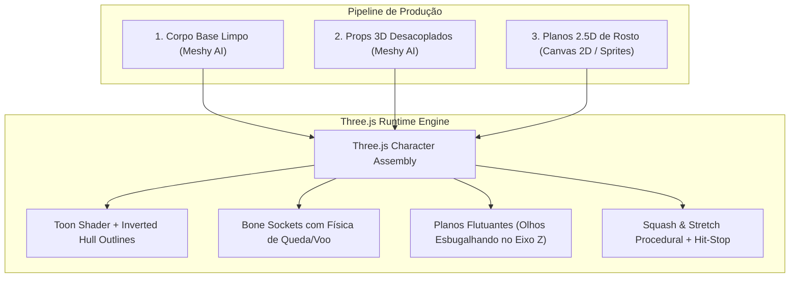

# [DOSSIÊ MESTRE] Transição 2D → 3D do KO-RAMA (Punch-Out 3D) via Meshy AI + Three.js

> **Destinatário:** Time de Desenvolvimento / Assistente AI (Claude)  
> **Jogo:** *KO-RAMA* (Arcade Boxing / Punch-Out!! Style)  
> **Motor Gráfico Alvo:** WebGL nativo via **Three.js** (60 FPS no navegador e desktop)  
> **Pipeline de Geração de Modelos:** **Meshy AI** (Image-to-3D / Text-to-3D com Auto-Rigging Mixamo)  
> **Estilo Visual:** Cel-Shading Low-Poly de Quadrinhos (*Spider-Verse* + *Punch-Out!! Wii* + *Guilty Gear*)

---

## 1. Visão Geral do Projeto & Objetivo

O **KO-RAMA** é um jogo de boxe arcade autoral e cômico inspirado diretamente no clássico imortal **Punch-Out!!** do Nintendo Wii. Atualmente com protótipo jogável em 2D/pseudo-3D com alta precisão de colisão e timing de esquiva/contra-ataque, o projeto está iniciando a transição definitiva para **modelos e cenários 3D em tempo real no Three.js**.

### O Desafio Central: Evitar a "Armadilha da IA 3D"
Ferramentas de IA generativa 3D (como o Meshy AI) são fantásticas para gerar **malhas fechadas (watertight) e texturas difusas estilizadas com rig bípede padrão**. No entanto, tentar gerar personagens prontos direto do forno da IA com roupas complexas, adereços soltos e rostos expressivos resulta em:
* Acessórios (chapéus, sombrinhas, cintos) colados ao corpo, deformando como borracha elástica na animação.
* Expressões faciais estáticas ou UVs do rosto borrados e distorcidos.
* Falta da física cômica exagerada característica de desenhos animados.

### A Solução da Engenharia: Os Truques de *Punch-Out!!* no Three.js
Para manter o desenvolvimento ágil e atingir uma fidelidade arcade inigualável, adotamos uma arquitetura modular em **3 Camadas**, inspirada nas técnicas de estúdios lendários como **Arc System Works** (*Guilty Gear*), **Nintendo / Next Level Games** (*Punch-Out!! Wii*) e **Capcom** (*Mega Man Legends*).

---

## 2. A Arquitetura das 3 Camadas



### Camada 1: O Corpo Base "Limpo" (Meshy AI)
* **Pose Padrão:** **A-Pose a 45°** (braços abertos a 45 graus com palmas viradas para a frente/baixo, pés retos alinhados aos ombros). Isso garante que o Auto-Rigging do Meshy/Mixamo nunca funda a axila com a caixa torácica.
* **Malha Fechada e Estanque:** Contém apenas a estrutura anatômica básica do personagem (pele, top/collant ou calção base).
* **Rosto Liso/Neutro:** Sem olhos esculpidos em 3D ou bocas abertas complexas (evitando artefatos de IA).

### Camada 2: Props Desacoplados em Sockets de Ossos (.glb independentes)
Adereços e armas nunca são modelados colados ao personagem. Eles são gerados como arquivos `.glb` separados e adicionados como filhos dos ossos do esqueleto Three.js:
* **Chapéus e Acessórios de Cabeça:** `headBone.add(chapeuMesh)`
* **Armas e Luvas:** `hand_R.add(armaMesh)` ou `hand_L.add(armaMesh)`
* **Mochilas e Baterias:** `spine2Bone.add(bateriaMesh)`

> **A Mágica do Impacto:** Quando o lutador leva um golpe forte, o chapéu sobe no eixo Y local (`position.y += 0.25`) com efeito elástico de mola. Em caso de contra-ataque crítico ou nocaute (KO), o Three.js desanexa o prop do osso, transfere para a cena global (`scene.attach(prop)`) e aplica um vetor de velocidade e gravidade, fazendo o chapéu **voar rodopiando pelo ringue**!

### Camada 3: Planos de Expressão 2.5D Flutuantes (Decals)
Inspirado em *The Legend of Zelda: The Wind Waker* e nos jogos da *Lego*:
* As expressões não são deformações 3D nem texturas pintadas na malha de IA.
* São **planos 2D poligonais levíssimos** (`THREE.PlaneGeometry`) posicionados a míseros `0.02` no eixo Z à frente do crânio, filhos do osso da cabeça (`headBone`).
* **Atlas 2D Modular:**
  * `eyesPlane`: Alterna entre *Neutro*, *Piscar*, *Fúria*, *Dor* e *Espirais de KO*.
  * `mouthPlane`: Alterna entre *Fechada*, *Sorriso Sarcástico*, *Grito de Ataque* e *Boca em O*.
* **O Efeito Looney Tunes / Tex Avery:** Em socos de nocaute, o plano dos olhos avança instantaneamente no eixo Z (`eyesPlane.position.z += 0.35`) e infla (`scale.set(2.2, 2.2, 1.0)`). O olho literalmente **pula para fora da cara** por 4 frames e volta com um estalo elástico!

---

## 3. O Segredo do "Game Feel" de *Punch-Out!!*

1. **Hit-Stop (Micro-Freeze de Colisão):**
   * No exato frame em que a luva atinge o queixo, o jogo congela o `mixer.timeScale = 0` por **60 a 90 milissegundos**.
   * Esse micro-congelamento cria a sensação física visceral de que o soco quebrou a barreira do som antes do adversário recuar.
2. **Squash & Stretch Procedural no Impacto:**
   * No momento do soco, o osso da cabeça/tronco deforma por escala via código:
     * **Frame 0 (Esmagamento lateral):** `headBone.scale.set(1.4, 0.6, 1.4)`
     * **Frame +3 (Rebote elástico vertical):** `headBone.scale.set(0.85, 1.25, 0.85)`
     * **Frame +6 (Retorno):** Volta a `(1.0, 1.0, 1.0)` com interpolação `elastic.out`.
3. **Inverted Hull Outlines (Contorno de Gibi sem Pós-Processamento Pesado):**
   * Malha duplicada com normais invertidas (`side: THREE.BackSide`), vértices ligeiramente inflados (`normal * 0.015`) e material preto fosco sem iluminação.
   * Roda a 60 FPS cravados até em dispositivos integrados de baixa potência.
4. **Partículas 2D em Espaço 3D (`THREE.Sprite`):**
   * Estrelas amarelas rodopiando, gotas de suor cartoon azuis espirrando e onomatopeias vibrantes (*"POW!"*, *"WHAM!"*, *"BAM!"*) dispostas como *billboards* sempre voltados para a câmera.

---

## 4. A Regra Anatômica dos Model Sheets: "Padrão Chunky" (3 a 3.5 Cabeças)

Todos os personagens do KO-RAMA foram calibrados rigorosamente no padrão de proporção **Chunky / Achatado**:
* **Altura Total:** 3 a 3.5 cabeças de altura (silhueta compacta e atarracada de fliperama).
* **Cabeça:** Ocupa entre **30% e 35% da altura total do corpo**, garantindo expressividade visual máxima a partir da câmera traseira do jogador.
* **Mãos e Luvas:** **Oversized / Gigantescas**, garantindo que o jogador consiga ler com total clareza a telegrafia dos golpes (se o golpe vem pela esquerda, direita, alto ou baixo).

---

## 5. Galeria Oficial do Elenco & Especificações Técnicas para o Meshy AI

Abaixo estão os **12 Model Sheets Técnicos Oficiais** (dupla vista ortográfica Front View & Back View sobre grid milimétrico) acompanhados de suas diretrizes exatas de geração no Meshy AI:

---

### 1. Jack Mãos de Colmeia ("O Apicultor Mutante")


* **Arquivo em disco:** [`modelsheets/modelsheet_jack.jpg`](file:///C:/Users/bento/.gemini/antigravity/scratch/punchout-3d/modelsheets/modelsheet_jack.jpg)
* **Conceito:** Apicultor parrudo em casaco verde militar e chapéu amarelo com pluma, que usa colmeias de vespas gigantescas nos punhos e controla enxames.
* **Corpo Base no Meshy AI:** Corpo em A-pose com o casaco verde e calças, chapéu amarelo com pluma e rosto com queixo quadrado sob o chapéu.
* **Props 3D Desacoplados (.glb):**
  * `prop_jack_beehive_L.glb`: Colmeia cônica estriada (punho esquerdo).
  * `prop_jack_beehive_R.glb`: Colmeia cônica estriada (punho direito).
  * `prop_jack_bee_single.glb`: Miniatura de 1 abelha estilizada em low-poly (instanciada em enxame orbitando o personagem).
* **Planos 2.5D de Rosto:** Olhos determinados cartoon e sobrancelhas grossas pretas.

---

### 2. King Frog ("O Rei dos Anfíbios")


* **Arquivo em disco:** [`modelsheets/modelsheet_frog.jpg`](file:///C:/Users/bento/.gemini/antigravity/scratch/punchout-3d/modelsheets/modelsheet_frog.jpg)
* **Conceito:** Sapo boxeador peso-médio arrogante e musculoso, vestindo calção de boxeador verde com debrum preto e dourado e pés anfíbios alaranjados.
* **Corpo Base no Meshy AI:** Corpo verde musculoso em A-pose de 3.5 cabeças com o calção verde e cinto dourado; **boca já aberta** com a cavidade pintada em preto fosco profundo `#0a0a0a`; luvas de boxe verdes nos punhos; **sem a coroa**.
* **Props 3D Desacoplados (.glb):**
  * `prop_frog_crown.glb`: Coroa dourada pontiaguda com gema vermelha central (`mixamorigHead`). *Efeito:* Voa rodopiando em arco no nocaute!
  * `prop_frog_tongue.glb`: Cilindro carnudo rosado procedural posicionado na boca, com escala em Z ativada apenas no frame do golpe de chicote.
* **Planos 2.5D de Rosto:** Olhos amarelos amendoados com pupilas pretas horizontais sobre as órbitas superiores.

---

### 3. Joana Cara-de-Craca ("A Corsária Crustácea")


* **Arquivo em disco:** [`modelsheets/modelsheet_joana.jpg`](file:///C:/Users/bento/.gemini/antigravity/scratch/punchout-3d/modelsheets/modelsheet_joana.jpg)
* **Conceito:** Capitã pirata crustácea atarracada com dreadlocks, chapéu tricórnio com cracas marinhas, calça listrada em vermelho e branco, e um olho telescópico pedunculado.
* **Corpo Base no Meshy AI:** Corpo pirata em A-pose com colete azul marinho, top listrado e calças de marujo; gancho de metal no punho esquerdo; **sem o chapéu e sem a garra de siri**.
* **Props 3D Desacoplados (.glb):**
  * `prop_joana_crab_claw.glb`: Garra colossal de siri laranja pontiaguda (`mixamorigRightHand`).
  * `prop_joana_pirate_hat.glb`: Chapéu tricórnio marrom com olho pedunculado acoplado (`mixamorigHead`). *Efeito:* Voa longe no golpe forte!
* **Planos 2.5D de Rosto:** Tapa-olho preto no olho esquerdo, boca com dentes trincados de marujo.

---

### 4. Valéria Vulcânica ("A Titã de Lava")


* **Arquivo em disco:** [`modelsheets/modelsheet_valeria.jpg`](file:///C:/Users/bento/.gemini/antigravity/scratch/punchout-3d/modelsheets/modelsheet_valeria.jpg)
* **Conceito:** Dançarina de frevo vulcânica em 3.5 cabeças com cabeleira volumosa de lava incandescente escorrendo gotas viscosas, top cropped vermelho e saia plissada curta.
* **Corpo Base no Meshy AI:** Corpo feminino atarracado e musculoso com top cropped vermelho, pernas curtas com botas ciano e fivelas douradas, cabeleira espetacular de lava; **sem a saia rodada e sem as sombrinhas**.
* **Props 3D Desacoplados (.glb):**
  * `prop_valeria_umbrella_L.glb`: Sombrinha de frevo aberta multifacetada (vermelho, amarelo, laranja, ciano).
  * `prop_valeria_umbrella_R.glb`: Sombrinha de frevo aberta multifacetada empunhada como manopla giratória.
  * `prop_valeria_skirt.glb`: Saia rodada plissada geométrica com faixas coloridas (`mixamorigHips` com *skirt bones* ou animação em keyframes).
* **Planos 2.5D de Rosto:** Rosto moreno com olhos amarelos ardentes e sorriso radiante de frevo.

---

### 5. O Cremoso ("O Golem de Baunilha")


* **Arquivo em disco:** [`modelsheets/modelsheet_cremoso.jpg`](file:///C:/Users/bento/.gemini/antigravity/scratch/punchout-3d/modelsheets/modelsheet_cremoso.jpg)
* **Conceito:** Golem peso-pesado em bloco de 3.5 cabeças feito de espirais densas e viscosas de sorvete de baunilha artesanal derretendo, avental branco com bolso de morango, caneleiras de casquinha waffle e punhos com morangos cravados.
* **Corpo Base no Meshy AI:** Golem de sorvete de baunilha amarelo-creme suave (`#fef08a`) com avental e caneleiras de casquinha; órbitas oculares ocas/escuras cavadas no creme; punhos de sorvete com morangos; **sem o chapéu de chef**.
* **Props 3D Desacoplados (.glb):**
  * `prop_cremoso_chef_hat.glb`: Chapéu branco clássico de confeiteiro/padeiro (`mixamorigHead`). *Efeito:* Pula no eixo Y em cada jab e voa rodopiando no nocaute!
* **Planos 2.5D de Rosto:** Sobrancelhas pretas grossas anguladas, bigodinho de creme em relevo e brilhos de pupila no fundo das cavidades ocas.

---

### 6. Maestra Vivaldi ("A Musicista Espectral")


* **Arquivo em disco:** [`modelsheets/modelsheet_vivaldi.jpg`](file:///C:/Users/bento/.gemini/antigravity/scratch/punchout-3d/modelsheets/modelsheet_vivaldi.jpg)
* **Conceito:** Maestrina fantasma barroca em proporção arcade compacta de 3.5 cabeças, feita 100% de ectoplasma verde-menta luminoso translúcido (zero carne humana), monumental peruca barroca em domo, casaca roxa nobre e cauda fantasmagórica flutuante (sem pernas).
* **Corpo Base no Meshy AI:** Corpo espectral completo em ectoplasma verde-menta claro (`#86efac`) com casaca violeta nobre (`#581c87`), dragonas douradas, jabot de renda branca, peruca de ectoplasma com laço roxo na nuca e cauda espectral; **sem a batuta**.
* **Props 3D Desacoplados (.glb):**
  * `prop_vivaldi_baton.glb`: Batuta clássica dourada de maestro com empunhadura esférica (`mixamorigRightHand`).
  * `prop_vivaldi_glasses.glb`: Óculos redondos dourados de leitura (*pince-nez*) com correntinha fina pendente (`mixamorigHead`).
* **Planos 2.5D de Rosto:** Rosto verde-menta com sorriso carismático e olhos dourados inteligentes.

---

### 7. Lady Espinha ("A Luchadora Mandacaru")


* **Arquivo em disco:** [`modelsheets/modelsheet_espinha.jpg`](file:///C:/Users/bento/.gemini/antigravity/scratch/punchout-3d/modelsheets/modelsheet_espinha.jpg)
* **Conceito:** Lutadora de lucha libre mexicana inspirada no cacto mandacaru, rosto belo e feminino homenageando Frida Kahlo (monocelha arqueada), cabeleira monumental de pétalas suculentas magenta com coroa dourada, collant azul royal totalmente fechado nas costas e punhos fechados boxeáveis armados com espinhos dourados.
* **Corpo Base no Meshy AI:** Corpo atlético de cacto verde com espinhos dourados ao longo dos membros, collant azul royal fechado nas costas com debrum laranja, coroa de pétalas magenta e punhos cerrados de boxeador com munhequeiras laranjas; **sem a faixa decorativa frontal**.
* **Props 3D Desacoplados (.glb):**
  * `prop_espinha_sash.glb`: Medalhão circular de ouro no umbigo com a faixa vertical de tecido (*taparubos* azul e laranja) pendendo entre as pernas (`mixamorigHips` com física pendular leve).
* **Planos 2.5D de Rosto:** Rosto feminino esculpido com a monocelha estilosa de Frida Kahlo, olhos amendoados negros com pupilas amarelas e sorriso provocador verde-escuro.

---

### 8. Dr. Marcov ("O Astronauta Quântico")


* **Arquivo em disco:** [`modelsheets/modelsheet_marcov.jpg`](file:///C:/Users/bento/.gemini/antigravity/scratch/punchout-3d/modelsheets/modelsheet_marcov.jpg)
* **Conceito:** Chimpanzé astronauta e cientista genial caricato com orelhas circulares proeminentes, tufo de cientista maluco, jaleco de laboratório branco aberto com canetas no bolso, peitoral com monitor cardíaco ciano neon, cauda preênsil dinâmica e manoplas pesadas de plasma.
* **Corpo Base no Meshy AI:** Corpo de primata em A-pose com traje espacial cinza escuro, jaleco branco aberto e cauda curvada; **sem as manoplas mecânicas de plasma**.
* **Props 3D Desacoplados (.glb):**
  * `prop_marcov_gauntlet_L.glb`: Manopla de plasma mecatrônica com bobinas de energia e capacitores (`mixamorigLeftForeArm`).
  * `prop_marcov_gauntlet_R.glb`: Manopla de plasma mecatrônica com bobinas de energia e capacitores (`mixamorigRightForeArm`).
* **Planos 2.5D de Rosto:** Rosto caricato com cicatriz na sobrancelha direita, focinho ranzinza e rugas de expressão cartoon.

---

### 9. Batalhator 2000 -- Fase 1 ("Blindagem de Titânio & Serras Circulares")


* **Arquivo em disco:** [`modelsheets/modelsheet_batalhator_fase1.jpg`](file:///C:/Users/bento/.gemini/antigravity/scratch/punchout-3d/modelsheets/modelsheet_batalhator_fase1.jpg)
* **Conceito:** Chefe final mecha brutal peso-pesado em aço titânio cinza rebitado com arranhões de combate, ombreiras zebradas amarelas e pretas com espinhos de aço, elmo cavaleiro com display de LED carmesim, duas serras circulares industriais nos punhos e uma bateria de carro 12V fixada nas costas com silver tape.
* **Corpo Base no Meshy AI:** Mecha maciço em A-pose com elmo, ombreiras zebradas e pernas pesadas de esteira industrial; **sem as serras circulares e sem a bateria**.
* **Props 3D Desacoplados (.glb):**
  * `prop_batalhator_saw_L.glb`: Serra circular de aço perfurada com rotação contínua no eixo local Z (`mixamorigLeftHand`).
  * `prop_batalhator_saw_R.glb`: Serra circular de aço perfurada com rotação contínua no eixo local Z (`mixamorigRightHand`).
  * `prop_batalhator_battery_12v.glb`: Bateria automotiva 12V preta com fitas silver tape prateadas (`mixamorigSpine2`).
* **Display 2D:** Visor retangular vermelho de LED com textura animada de onda cardíaca/digital.

---

### 10. Batalhator 2000 -- Fase 2 ("Modo Fúria & Cockpit Aberto")


* **Arquivo em disco:** [`modelsheets/modelsheet_batalhator_fase2.jpg`](file:///C:/Users/bento/.gemini/antigravity/scratch/punchout-3d/modelsheets/modelsheet_batalhator_fase2.jpg)
* **Conceito:** O robô sofreu a primeira queda e entrou em sobrecarga! A blindagem peitoral de escudo se abriu para a frente, revelando o cockpit interno com **O Nerd Piloto visível lá dentro** operando joysticks em pânico! Serras em brasa incandescente alaranjada e ombreiras abertas com micro-mísseis.
* **Corpo Base no Meshy AI:** Mecha avariado com a escotilha peitoral aberta e cavidade oca da cabine de comando.
* **Props 3D Desacoplados (.glb):**
  * `prop_nerd_cockpit_pilot.glb`: Busto e cabeça do Nerd em polo verde-petróleo, headset vermelho e óculos, manobrando duas alavancas de controle (`cockpitBone`).
  * `prop_batalhator_saws_heat.glb`: Serras circulares incandescentes em brasa alaranjada soltando labaredas.
  * `prop_batalhator_battery_damaged.glb`: Bateria 12V chamuscada cuspindo faíscas elétricas.

---

### 11. O Nerd Operador -- Fase 3 ("A Batalha Final a Pé")


* **Arquivo em disco:** [`modelsheets/modelsheet_batalhator_fase3.jpg`](file:///C:/Users/bento/.gemini/antigravity/scratch/punchout-3d/modelsheets/modelsheet_batalhator_fase3.jpg)
* **Conceito:** O mecha explodiu! Quem sobrou no ringue para a fase final é o próprio criador e piloto em pessoa: um rapaz franzino geek em camisa polo verde-petróleo com bolso e canetas, bermuda cáqui, meias altas e tênis retrô, lutando no desespero absoluto em guarda estabanada!
* **Corpo Base no Meshy AI:** Rapaz franzino em polo verde e bermuda cáqui em A-pose; **sem o headset, sem os óculos e sem o joystick pendurado**.
* **Props 3D Desacoplados (.glb):**
  * `prop_nerd_headset.glb`: Headset gamer vermelho vibrante com microfone perto da boca (`mixamorigHead`). *Efeito:* Cai no chão ao ser nocauteado!
  * `prop_nerd_glasses.glb`: Óculos grossos de armação preta com esparadrapo branco na ponte nasal (`mixamorigHead`). *Efeito:* Entortam na cara quando leva um cruzado!
  * `prop_nerd_joystick.glb`: Controle industrial de fliperama quebrado com fiação pendurado no cinto (`mixamorigHips`).
* **Planos 2.5D de Rosto:** Olhos arregalados de pânico, boca gritando de desespero e **gotas gigantescas de suor cartoon** espirrando da cabeça.

---

### 12. O Espantalho ("O Boneco de Treino / Sparring Dummy")


* **Arquivo em disco:** [`modelsheets/modelsheet_espantalho.jpg`](file:///C:/Users/bento/.gemini/antigravity/scratch/punchout-3d/modelsheets/modelsheet_espantalho.jpg)
* **Conceito:** Boneco de treino de boxe feito de um poste central de madeira revestido por estopa e palha seca amarrados com cordas, camisa flanela xadrez puída com remendos coloridos, olhos de botões de camisa, chapéu de palha esfarrapado e luvas de boxe rústicas de estopa cheias de palha.
* **Corpo Base no Meshy AI:** Boneco de estopa e camisa xadrez em A-pose com o poste de suporte visível nas costas; **sem o chapéu de palha e sem as luvas de estopa**.
* **Props 3D Desacoplados (.glb):**
  * `prop_espantalho_hat.glb`: Chapéu cônico de palha rústico esfarrapado com aba dobrada (`mixamorigHead`). *Efeito:* Voa longe já no primeiro golpe da luta!
  * `prop_espantalho_gloves.glb`: Luvas arredondadas volumosas de estopa estufadas de palha (`mixamorigLeftHand` / `RightHand`).
* **Planos 2.5D de Rosto:** Olhos de botões pretos de camisa e boca em costura preta de linha zigue-zague.

---

## 6. Roteiro Prático de Implementação (Passo a Passo para o Claude / Dev)

Para colocar a esteira 3D em funcionamento, o desenvolvedor ou assistente AI deve seguir esta ordem cronológica de tarefas:

### Passo 1: O Teste Piloto (King Frog ou Jack)
1. **Gerar a Malha Base no Meshy AI:**
   * Fazer upload da imagem recortada de **King Frog** (sem coroa e sem língua) em modo **Image-to-3D** com o preset de estilo *"Stylized / Cartoon Low-Poly"*.
   * Baixar o arquivo `.glb` resultante com a opção de **Auto-Rigging bípede (Mixamo standard)** ativada.
2. **Gerar os Props via Text-to-3D no Meshy:**
   * Prompt da Coroa: *"A stylized low-poly golden royal king crown with red rubies, watertight 3D game prop asset."* -> Exportar como `prop_frog_crown.glb`.
   * Prompt da Língua: Modelo cilíndrico carnudo rosado procedural.
3. **Montagem no Three.js Sandbox (`arena_viewer`):**
   * Carregar o personagem via `THREE.GLTFLoader`.
   * Localizar o osso da cabeça: `const headBone = frogMesh.getObjectByName("mixamorigHead")`.
   * Anexar a coroa: `headBone.add(crownMesh); crownMesh.position.set(0, 0.28, 0)`.
   * Adicionar o plano de olhos 2.5D: `headBone.add(eyesPlane)`.

### Passo 2: O Shader Cel-Shading & Outlines no Three.js
Substituir os materiais originais do GLTF por um `THREE.MeshToonMaterial` com textura de rampa de iluminação em 3 tons (`gradientMap`) e criar a malha de contorno nanquim com `THREE.BackSide`:

```javascript
function applyComicCelShading(model, outlineThickness = 0.015) {
  // Gradiente de 3 tons para iluminação cel-shaded
  const format = THREE.RGBAFormat;
  const colors = new Uint8Array([70, 70, 70, 255, 160, 160, 160, 255, 255, 255, 255, 255]);
  const gradientMap = new THREE.DataTexture(colors, 3, 1, format);
  gradientMap.needsUpdate = true;

  model.traverse((child) => {
    if (child.isMesh && !child.userData.isOutline) {
      // 1. Material Toon Principal
      const oldMat = child.material;
      child.material = new THREE.MeshToonMaterial({
        map: oldMat.map,
        color: oldMat.color,
        gradientMap: gradientMap,
      });

      // 2. Inverted Hull Outline Mesh
      const outlineGeo = child.geometry.clone();
      const outlineMat = new THREE.MeshBasicMaterial({
        color: 0x000000,
        side: THREE.BackSide,
      });
      const outlineMesh = new THREE.Mesh(outlineGeo, outlineMat);
      outlineMesh.userData.isOutline = true;
      outlineMesh.scale.multiplyScalar(1.0 + outlineThickness);
      child.add(outlineMesh);
    }
  });
}
```

### Passo 3: O Gatilho de Impacto de Punch-Out!!
Ligar o evento de soco à física de impacto:

```javascript
function onOpponentPunched(opponent, punchType) {
  // 1. Hit-Stop (Micro-congelamento de 70ms)
  mixer.timeScale = 0;
  setTimeout(() => { mixer.timeScale = 1; }, 70);

  // 2. Squash & Stretch na Cabeça
  const head = opponent.getObjectByName("mixamorigHead");
  if (head) {
    head.scale.set(1.4, 0.6, 1.4); // Esmaga lateralmente
    gsap.to(head.scale, {
      x: 0.85, y: 1.25, z: 0.85, // Rebote vertical
      duration: 0.06,
      onComplete: () => {
        gsap.to(head.scale, { x: 1, y: 1, z: 1, duration: 0.1, ease: "elastic.out(1, 0.3)" });
      }
    });
  }

  // 3. Olhos 2D Pulam pra Fora (Efeito Looney Tunes)
  const eyes = opponent.getObjectByName("eyesPlane");
  if (eyes) {
    gsap.to(eyes.position, { z: 0.45, duration: 0.05, yoyo: true, repeat: 1 });
    gsap.to(eyes.scale, { x: 2.2, y: 2.2, duration: 0.05, yoyo: true, repeat: 1 });
  }

  // 4. Salto / Queda do Chapéu / Coroa
  const hat = opponent.getObjectByName("propHat");
  if (hat && punchType === "COUNTER_HIT") {
    // Desacopla no mundo e voa!
    scene.attach(hat);
    hat.userData.velocity = new THREE.Vector3(0, 3.5, -2.0);
  }
}
```

---

## 7. Mapeamento de Diretórios Locais

Todos os arquivos de model sheet e especificações já estão salvos e sincronizados nos seguintes diretórios da máquina:

* **Diretório dos Model Sheets Oficiais (JPG em alta resolução):**
  `C:\Users\bento\.gemini\antigravity\scratch\punchout-3d\modelsheets\`
  * `modelsheet_jack.jpg`
  * `modelsheet_frog.jpg`
  * `modelsheet_joana.jpg`
  * `modelsheet_valeria.jpg`
  * `modelsheet_cremoso.jpg`
  * `modelsheet_vivaldi.jpg`
  * `modelsheet_espinha.jpg`
  * `modelsheet_marcov.jpg`
  * `modelsheet_batalhator_fase1.jpg`
  * `modelsheet_batalhator_fase2.jpg`
  * `modelsheet_batalhator_fase3.jpg`
  * `modelsheet_espantalho.jpg`
* **Sandbox / Ferramentas 3D Existentes no Projeto:**
  * Visualizador WebGL de Estudos: `C:\Users\bento\.gemini\antigravity\scratch\punchout-3d\tools\`
  * Engine C++ / Wasm: `C:\Users\bento\.gemini\antigravity\scratch\punchout-3d\engine-cpp\`
  * Sprites Originais: `C:\Users\bento\.gemini\antigravity\scratch\punchout-3d\dist\KO-RAMA\assets\sprites\`

---

*Fim do Dossiê Mestre de Transição 3D.*
